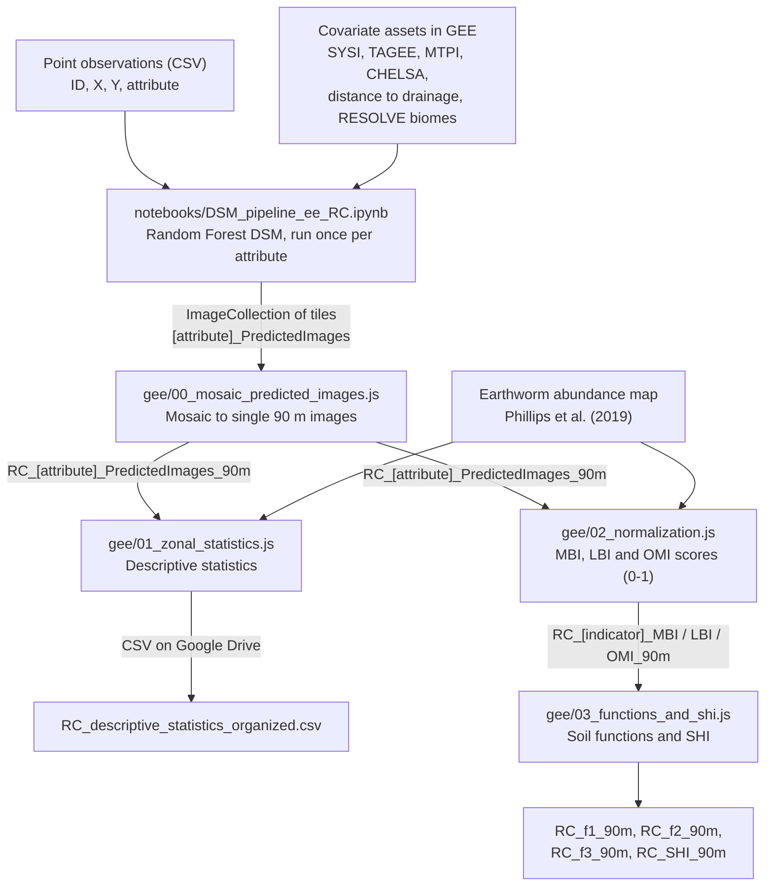

# Spatial assessment of soil health in the Czech Republic

Code for mapping soil attributes and computing a spatial **Soil Health Index (SHI)** for the Czech Republic with Digital Soil Mapping (DSM) in Google Earth Engine (GEE).

> **Status:** this repository accompanies a scientific article that is currently unpublished. The article reference, the origin of the soil function weights and the licence will be added upon publication (see [Citation](#citation)).

---

## Contents

- [Project overview](#project-overview)
- [Scientific background](#scientific-background)
- [Workflow](#workflow)
- [Repository structure](#repository-structure)
- [Input datasets](#input-datasets)
- [Methodology](#methodology)
- [Installation and requirements](#installation-and-requirements)
- [Quick start: soil organic carbon example](#quick-start-soil-organic-carbon-example)
- [Complete workflow](#complete-workflow)
- [Outputs](#outputs)
- [Reproducibility and limitations](#reproducibility-and-limitations)
- [Citation](#citation)
- [License and acknowledgments](#license-and-acknowledgments)

---

## Project overview

The workflow combines five steps:

1. **Digital Soil Mapping** of seven soil attributes (total N, available P, exchangeable K, pH in water, effective cation exchange capacity, soil organic carbon and bulk density) with Random Forest models trained in GEE from point observations and environmental covariates (multitemporal surface reflectance, terrain, climate and hydrography). One model is fitted per attribute, with hyperparameter tuning, 10-fold cross-validation and 100 bootstrap iterations for uncertainty.
2. **Mosaicking** of the tiled predictions into single 90 m images.
3. **Descriptive statistics** of the attribute maps within the Czech Republic boundary.
4. **Normalization** of eight indicators (the seven attributes plus earthworm abundance) into unitless scores (0–1) with non-linear scoring functions.
5. **Integration** of the scores into three soil functions and into the Soil Health Index.

The DSM step runs in Python (Jupyter or Google Colab) through the Earth Engine Python API; all subsequent steps run in the GEE Code Editor (JavaScript).

## Scientific background

Soil health is the capacity of soil to function as a living system that sustains biological productivity, environmental quality and plant and animal health. Because soil health cannot be measured directly, it is commonly assessed by selecting soil indicators, transforming them into scores that express how favourable each value is, and integrating the scores into soil functions and an overall index.

Digital Soil Mapping makes this assessment spatially explicit: machine-learning models relate point observations of soil attributes to environmental covariates and predict each attribute continuously across the landscape. Applying the scoring and integration steps to these maps produces wall-to-wall maps of soil functions and soil health that can support land management and policy at national scale.

This workflow follows the methodologies of Poppiel et al. (2025) and Greschuk et al. (2023) (see [Citation](#citation)). The DSM notebook is adapted from the geospatial mapping pipeline of van den Hoogen et al. (2021).

## Workflow



## Repository structure

```text
.
├── README.md                     This file
├── CITATION.cff                  Citation metadata (to be completed upon publication)
├── LICENSE                       MIT License
├── THIRD_PARTY_NOTICES.md        Licence of the adapted third-party code
├── requirements.txt              Python dependencies of the DSM notebook
├── .gitignore
├── notebooks/
│   └── DSM_pipeline_ee_RC.ipynb  Step 1: Digital Soil Mapping (Python, Earth Engine API)
├── gee/
│   ├── 00_mosaic_predicted_images.js   Step 2: mosaic of the tiled predictions
│   ├── 01_zonal_statistics.js          Step 3: descriptive statistics
│   ├── 02_normalization.js             Step 4: indicator scoring
│   └── 03_functions_and_shi.js         Step 5: soil functions and SHI
├── data/
│   └── examples/
│       ├── README.md
│       └── RC_LUCAS_C_gkg.csv    Example input: LUCAS soil organic carbon points
└── docs/
    ├── methodology.md            Detailed description of every step and parameter
    └── data_requirements.md      Input format, GEE assets, accounts and outputs
```

## Input datasets

### Point observations

The DSM notebook takes one CSV file per soil attribute, with one row per observation:

| Column | Description |
|---|---|
| `ID_Original` | Identifier of the observation (not used by the models) |
| `X` | Longitude, decimal degrees, WGS 84 (EPSG:4326) |
| `Y` | Latitude, decimal degrees, WGS 84 (EPSG:4326) |
| `<attribute>` | Measured value of the soil attribute, e.g. `C_gkg` (soil organic carbon, g kg⁻¹) |

The column names of the coordinates and of the attribute are configurable in the notebook (`longString`, `latString`, `classProperty`).

**Example dataset.** `data/examples/RC_LUCAS_C_gkg.csv` contains 1,324 topsoil organic carbon observations from the LUCAS survey within the study bounding box. It illustrates the input format and allows the complete DSM step to be run. **It is not the training dataset of the article**, which also includes confidential data that cannot be shared. See [data/examples/README.md](data/examples/README.md) for details and for the conditions of use of LUCAS data.

### Covariates and auxiliary layers

All covariates are Earth Engine assets with public read access in the project `ee-geocisworldspecs-203`:

| Asset | Bands used | Description |
|---|---|---|
| `SyVI_RC_1984_2023` | blue, green, red, nir, swir1, swir2 | Multitemporal reflectance composite, 1984–2023 (SYSI) (Demattê et al., 2018)|
| `TAGEE_RC_30m` | 12 terrain attributes | Terrain attributes computed with TAGEE (Safanelli et al., 2020) |
| `MultiScaleTopographicPositionIndex_RC_90m` | MultiScaleTopographicPositionIndex | Multi-scale topographic position index (Theobald et al., 2015) |
| `EuclideanDistance_toWater_RC_90m_ORD_STRA_3` | EuclideanDistance_toWater | Euclidean distance to drainage |
| `CHELSA_BIO_RC_90m` | 4 bioclimatic variables | CHELSA bioclimatic variables (Karger et al., 2017) |
| `example_composite_30ArcSec_RC_90m` | Resolve_Biome | RESOLVE ecoregions/biomes (Dinerstein et al., 2017), from the composite of van den Hoogen et al.; used only for stratification |
| `Earthworms_Abundance` | single band | Earthworm abundance (Phillips et al., 2019) |
| `world_simplyfied` | — | Country outlines, used only to build the export tile grid |
| `RC_Limits` | — | Czech Republic boundary |

The DSM step also uses the public catalogue dataset `MERIT/DEM/v1_0_3` (Yamazaki et al., 2017) as a land mask. The full list of covariate bands is given in [docs/methodology.md](docs/methodology.md).

## Methodology

A detailed description of every step, including all parameter values, is given in [docs/methodology.md](docs/methodology.md). The main elements are summarized below.

### 1. Digital Soil Mapping (`notebooks/DSM_pipeline_ee_RC.ipynb`)

- **Data preparation:** observations without values are removed, values are rounded (2 decimal places) and the points are uploaded to GEE and filtered to the study bounding box (10.60–20.16° E, 47.46–52.18° N).
- **Covariate sampling and pixel aggregation:** the 24 covariates are sampled at each point at 30 m; observations falling in the same 30 m pixel are averaged.
- **Cross-validation folds:** 10 folds, assigned at random within each RESOLVE biome.
- **Hyperparameter tuning:** grid search over Random Forest models (`ee.Classifier.smileRandomForest`, regression mode, 20 trees, bag fraction 0.632, seed 42) with variables per split ∈ {4, 8, 12, 16, 20, 24}, minimum leaf population ∈ {3, 6, 9} and maximum nodes ∈ {500, 1000, 1500} (54 models). Models are ranked by the mean cross-validated R²; RMSE and RPIQ are also reported.
- **Prediction and uncertainty:** the best model is refitted on 100 bootstrap samples, stratified by biome according to the area proportion of each biome in the study area. The bootstrap mean is the final prediction, and the 2.5th and 97.5th bootstrap percentiles define the 95 % confidence interval.
- **Export:** the prediction and its confidence interval are exported at 90 m (EPSG:4326) as an ImageCollection of tiles.

### 2–3. Mosaic and descriptive statistics (`gee/00`, `gee/01`)

The tiles of each attribute are mosaicked into a single image on the original 90 m pixel grid. Descriptive statistics (mean, standard deviation, minimum, maximum, pixel count and 5th, 25th, 50th, 75th and 95th percentiles) are computed for each indicator within the Czech Republic boundary.

### 4. Indicator normalization (`gee/02_normalization.js`)

Each indicator is transformed into a score between 0 and 1 with one of three non-linear scoring functions:

**More is better** (N, P, K, CEC, SOC and earthworm abundance):

$$
MBI = \begin{cases}
\dfrac{a}{1 + \left(\dfrac{B - U_L}{x - U_L}\right)^{S}} & x < U_L \\[2ex]
a & x \geq U_L
\end{cases}
$$

**Less is better** (bulk density):

$$
LBI = \begin{cases}
\dfrac{a}{1 + \left(\dfrac{B - L_L}{x - L_L}\right)^{S}} & x > L_L \\[2ex]
a & x \leq L_L
\end{cases}
$$

**Optimal midpoint** (pH in water):

$$
OMI = \begin{cases}
\dfrac{a}{1 + \left(\dfrac{B_L - O}{x - O}\right)^{S}} & x < O \\[2ex]
a & x = O \\[1ex]
\dfrac{a}{1 + \left(\dfrac{B_U - O}{x - O}\right)^{S}} & x > O
\end{cases}
$$

where $a$ is the maximum score (1), $S$ is the slope of the curve (−2.5), $B$ is the baseline value with a score of 0.5 (the median), $U_L$ and $L_L$ are the upper and lower limits of the attribute values (score of 1), $B_L$ and $B_U$ are the lower and upper baselines of the optimal midpoint curve (score of 0.5), $O$ is the optimal value (score of 1) and $x$ is the value of the soil attribute.

In this study, the limits and baselines are percentiles of each indicator map within the Czech Republic: $B$ = 50th percentile; $U_L$ and $B_U$ = 95th percentile; $L_L$ and $B_L$ = 5th percentile; and $O$ = 6.5 for pH. The percentiles and the optimum are set at the top of `02_normalization.js` (`LOWER_PERCENTILE`, `UPPER_PERCENTILE`, `OPTIMUM_PH`) and can be changed, for example, to the minimum and maximum. All scores are clamped to [0, 1].

### 5. Soil functions and Soil Health Index (`gee/03_functions_and_shi.js`)

The scores are combined by weighted sums into three soil functions:

$$
f_1 = 0.1\overline{3}\,N + 0.1\overline{3}\,P + 0.1\overline{3}\,K + 0.4\,pH + 0.2\,CEC
$$

$$
f_2 = 0.5\,EW + 0.5\,SOC
$$

$$
f_3 = BD
$$

where $f_1$ is the storage, availability and cycling of nutrients, $f_2$ is carbon storage, $f_3$ is the support for plant growth, $EW$ is the earthworm abundance score and $BD$ is the bulk density score. The Soil Health Index is

$$
SHI = 0.34\,f_1 + 0.33\,f_2 + 0.33\,f_3
$$

The weights of each function and of the SHI sum to 1, so all outputs range from 0 to 1. The rationale for the weights is described in the article (to be added upon publication).

## Installation and requirements

### Accounts and access

- A **Google account registered for Earth Engine** and a **Google Cloud project** with the Earth Engine API enabled ([Earth Engine access](https://developers.google.com/earth-engine/guides/access)).
- An **Earth Engine asset root** where the notebook can write. New users must use a Cloud project root, `projects/<your-project>/assets`. Legacy roots (`users/<username>`) cannot be created by new accounts; users who already own one may keep using it.
- A **Google Cloud Storage bucket**, used only as temporary storage for the bootstrap table (see [docs/data_requirements.md](docs/data_requirements.md#cloud-storage-bucket)). Disable soft delete on this bucket so that the temporary file is not retained and billed after deletion.
- Read access to the shared assets in `ee-geocisworldspecs-203`, which are public.

### Python environment (DSM notebook)

The notebook was tested with Python 3.12 in a local Jupyter environment on Windows. It can also be run in Google Colab.

```bash
pip install -r requirements.txt
```

The `earthengine` command-line tool, installed with `earthengine-api`, must be available on the system PATH, or its full path must be set in `bashFunction_EarthEngine` in the notebook.

### Authentication

Run the first cell of the notebook (`ee.Authenticate()`) and follow the instructions. The same credentials are used by the Python API, by the `earthengine` command-line tool and by the Cloud Storage client. In Google Colab, if the Cloud Storage client fails to authenticate, run `from google.colab import auth; auth.authenticate_user()` before the bootstrap cell.

### GEE Code Editor scripts

The scripts in `gee/` need no installation: open the [Code Editor](https://code.earthengine.google.com/), paste a script, edit the settings marked `USER SETTING` (if any), click **Run** and start the export tasks in the **Tasks** tab.

## Quick start: soil organic carbon example

This example maps soil organic carbon from the LUCAS example dataset.

1. Create a working folder `data/` next to the notebook and copy `data/examples/RC_LUCAS_C_gkg.csv` into it.
2. Open `notebooks/DSM_pipeline_ee_RC.ipynb` and set the values marked `USER SETTING`:

   ```python
   projectIdGEE = 'your-gee-cloud-project'                 # section 1
   assetRootGEE = 'projects/'+projectIdGEE+'/assets'       # section 2
   GCBbucketname = 'your-gcs-bucket'                       # bucket name only, no '/'
   GCSfolder = ''                                          # optional folder inside the bucket
   titleOfRawPointCollection = 'RC_LUCAS_C_gkg'            # CSV name without '.csv'
   classProperty = 'C_gkg'
   projectFolder = 'RC_C_gkg'
   holdingFolder = './data'
   outputFolder = './data/Maps'
   ```

3. Run the notebook from top to bottom. The cells marked **"RUN (the next cell) ONLY AFTER…"** must wait for the corresponding Earth Engine tasks to finish; the preceding *Break and wait* cells pause until then. The cell *Check Grid Search results and RE-RUN failed tasks* is an optional recovery step.
4. When the final export tasks have finished, the asset `<assetRootGEE>/RC_C_gkg/C_gkg_PredictedImages` contains the predicted map (4 tiles).

In our test run with this dataset, the 1,324 observations were reduced to 1,315 after pixel aggregation, and the best model reached a mean cross-validated R² of about 0.38 (RMSE ≈ 15.2 g kg⁻¹). The steps from data upload to the start of the final export took about three hours, mostly spent waiting for Earth Engine tasks. These values refer to the example dataset only and are not results of the article.

## Complete workflow

1. **DSM (notebook)** — run the notebook once per soil attribute, changing `titleOfRawPointCollection`, `classProperty` and `projectFolder`. Each run creates the folder `<assetRootGEE>/<projectFolder>` with the training data, grid search results, bootstrap samples and the ImageCollection `<classProperty>_PredictedImages`. The `strataDict` proportions (area share of each biome) were computed for the Czech Republic study area and must be recalculated for other areas.
2. **Mosaic (`gee/00_mosaic_predicted_images.js`)** — set the input ImageCollection (`collection`) and the output asset (`outputAsset`) and run the script once per attribute. The tiles are mosaicked into a single image with all bands, keeping the original 90 m pixels (`RC_<attribute>_PredictedImages_90m`).
3. **Statistics (`gee/01_zonal_statistics.js`)** — exports `RC_descriptive_statistics_organized.csv` to the Google Drive folder `RC_descriptive_statistics`.
4. **Normalization (`gee/02_normalization.js`)** — prints the percentiles of each indicator in the Console and exports eight score maps.
5. **Soil functions and SHI (`gee/03_functions_and_shi.js`)** — exports the three soil functions and the SHI.

Steps 3 and 4 are independent; step 5 requires step 4. The scripts in `gee/` read and write the assets of the project `ee-geocisworldspecs-203`. To run them on your own outputs, replace `projects/ee-geocisworldspecs-203/assets/` in the input and output asset IDs with your asset root (the earthworm map, the covariates and `RC_Limits` can still be read from the shared project).

## Outputs

| Step | Output | Location | Description |
|---|---|---|---|
| 1 | `<attribute>_training_data*`, `<attribute>_bootstrapSamples` | GEE assets | Training data (with covariates and folds) and bootstrap samples |
| 1 | `<attribute>_grid_search_results_mean` / `_StDev` | GEE assets and local CSV | Cross-validation metrics (R², RMSE, RPIQ) of the 54 models |
| 1 | `<attribute>_featureImportances.csv` | Local CSV | Mean normalized variable importance of the top 10 models |
| 1 | `<attribute>_PredictedImages` | GEE ImageCollection | Tiles with bands `_PredictedBootstrapMean`, `_lower`, `_upper` (90 m) |
| 2 | `RC_<attribute>_PredictedImages_90m` | GEE assets | Single-image version of each prediction |
| 3 | `RC_descriptive_statistics_organized.csv` | Google Drive | Attribute, Mean, SD, Min, Max, Count, P5, P25, P50, P75, P95 |
| 4 | `RC_<indicator>_MBI_90m`, `RC_BD_kgdm_LBI_90m`, `RC_pH_H2O_OMI_90m` | GEE assets | Indicator scores (0–1), band `constant` |
| 5 | `RC_f1_90m`, `RC_f2_90m`, `RC_f3_90m`, `RC_SHI_90m` | GEE assets | Soil functions and Soil Health Index (0–1), band `constant` |

The full list of output names per attribute is given in [docs/data_requirements.md](docs/data_requirements.md#outputs).

## Reproducibility and limitations

**What can be reproduced.** The complete workflow can be executed with the example dataset and the shared covariate assets. Steps 2–5 can be reproduced exactly from the shared maps of the article. The DSM maps of the article cannot be regenerated by third parties, because part of the training data is confidential.

**Determinism.** Fold assignment, Random Forest models and bootstrap sampling use fixed seeds. Results obtained with the same data and settings should be very close; small differences can arise from changes in Earth Engine or in library versions.

**Known limitations and issues.** The following points are documented but intentionally not changed, so that the code reproduces the published analysis:

- The model ranking sorts in descending order, which is correct for `Mean_R2` (the setting used) but not for `Mean_RMSE`; `Mean_MAE` is not computed.
- With small datasets, the `maxNodes` values may have no effect (identical metrics), so the grid contains fewer distinct models than its 54 combinations. In the example run there were 18 distinct models, and the top-10 ensemble used for variable importance contained repeated models.
- The final map is the bootstrap mean of the single best model; the ensemble prediction, the bootstrap standard deviation and coefficient of variation, and the interpolation/extrapolation layers are computed but not exported.
- The spatial leave-one-out cross-validation (SLOO-CV) section is optional and was not used: in ensemble mode it evaluates a different model for each buffer size, and the option `loo_cv_wPointRemoval` calls an undefined function.
- The optional re-run check of the grid search depends on Windows line endings (`'\r'`) and reports every task as failed on Linux or Colab.
- The training data come from the whole bounding box, which includes parts of neighbouring countries; the predictions also cover the bounding box, whereas statistics, scores and the SHI are restricted to the Czech Republic boundary.
- The exports of `02_normalization.js` and `03_functions_and_shi.js` use `scale: 90` without `crsTransform`, which redefines the 90 m pixel grid with an offset of less than one pixel relative to the DSM maps (nearest-neighbour resampling).
- Earth Engine percentiles are estimated from histograms and are approximate.
- The scores are relative to the distribution of each indicator in the study area (percentile-based limits), except for the pH optimum.
- The optimal midpoint function requires $B_L < O < B_U$; otherwise, the affected pixels become invalid (masked).
- Pixels without a valid value in any indicator (e.g., outside the coverage of the earthworm map) are masked in the corresponding function and in the SHI.
- The notebook emits pandas deprecation warnings in the bootstrap sampling; `requirements.txt` restricts pandas to versions below 3.0, whose new `groupby().apply()` behaviour would change the bootstrap table.

**Computational requirements.** All heavy computation runs on Earth Engine servers. The bootstrap table (100 iterations × number of observations × ~28 columns) is written locally and to the Cloud Storage bucket, and can reach hundreds of megabytes for large datasets.

## Citation

**Article:** to be added upon publication.

**This repository:** see [`CITATION.cff`](CITATION.cff) (GitHub shows a *Cite this repository* button).

**Methodological references:**

- Poppiel, R.R., Cherubin, M.R., Novais, J.J.M. et al. (2025). Soil health in Latin America and the Caribbean. *Communications Earth & Environment*, 6, 141. https://doi.org/10.1038/s43247-025-02021-w
- Greschuk, L.T., Demattê, J.A.M., Silvero, N.E.Q. et al. (2023). A soil productivity system reveals most Brazilian agricultural lands are below their maximum potential. *Scientific Reports*, 13, 14103. https://doi.org/10.1038/s41598-023-39981-y
- van den Hoogen, J. et al. (2021). A geospatial mapping pipeline for ecologists. *bioRxiv*. https://doi.org/10.1101/2021.07.07.451145

**Data references:**

- Panagos, P., van Liedekerke, M., Borrelli, P., Köninger, J., Ballabio, C., Orgiazzi, A., Lugato, E., Liakos, L., Hervas, J., Jones, A., & Montanarella, L. (2022). European Soil Data Centre 2.0: Soil data and knowledge in support of the EU policies. *European Journal of Soil Science*, 73(6), e13315. https://doi.org/10.1111/ejss.13315
- Panagos, P., van Liedekerke, M., Jones, A., & Montanarella, L. (2012). European Soil Data Centre: Response to European policy support and public data requirements. *Land Use Policy*, 29(2), 329–338. https://doi.org/10.1016/j.landusepol.2011.07.003
- Panagos, P., Vieira, D., Eekhout, J.P.C., Biddoccu, M., Cerdà, A., Evans, D.L., Tavoularis, N., Bezak, N., Negrel, P., Katsoyiannis, A., & Borrelli, P. (2024). How the EU Soil Observatory contributes to a stronger soil erosion community. *Environmental Research*, 248, 118319. https://doi.org/10.1016/j.envres.2024.118319
- Phillips, H.R.P., Guerra, C.A., Bartz, M.L.C. et al. (2019). Global distribution of earthworm diversity. *Science*, 366(6464), 480–485. https://doi.org/10.1126/science.aax4851
- Safanelli, J.L., Poppiel, R.R., Ruiz, L.F.C. et al. (2020). Terrain Analysis in Google Earth Engine: a method adapted for high-performance global-scale analysis. *ISPRS International Journal of Geo-Information*, 9(6), 400. https://doi.org/10.3390/ijgi9060400
- Theobald, D.M., Harrison-Atlas, D., Monahan, W.B., & Albano, C.M. (2015). Ecologically-relevant maps of landforms and physiographic diversity for climate adaptation planning. *PLoS ONE*, 10(12), e0143619. https://doi.org/10.1371/journal.pone.0143619
- Karger, D.N., Conrad, O., Böhner, J. et al. (2017). Climatologies at high resolution for the earth's land surface areas. *Scientific Data*, 4, 170122. https://doi.org/10.1038/sdata.2017.122
- Dinerstein, E., Olson, D., Joshi, A. et al. (2017). An ecoregion-based approach to protecting half the terrestrial realm. *BioScience*, 67(6), 534–545. https://doi.org/10.1093/biosci/bix014
- Yamazaki, D., Ikeshima, D., Tawatari, R. et al. (2017). A high-accuracy map of global terrain elevations. *Geophysical Research Letters*, 44, 5844–5853. https://doi.org/10.1002/2017GL072874
- Demattê, J.A.M., Fongaro, C.T., Rizzo, R., & Safanelli, J.L. (2018). Geospatial Soil Sensing System (GEOS3): A powerful data mining procedure to retrieve soil spectral reflectance from satellite images. Remote Sensing of Environment, 212, 161–175. https://doi.org/10.1016/j.rse.2018.04.047
- Cherubin, M.R., Karlen, D.L., Cerri, C.E.P., Franco, A.L.C., Tormena, C.A., Davies, C.A., & Cerri, C.C. (2016). Soil quality indexing strategies for evaluating sugarcane expansion in Brazil. PLOS ONE, 11(3), e0150860. https://doi.org/10.1371/JOURNAL.PONE.0150860

## License and acknowledgments

**Licence:** the code in this repository is distributed under the [MIT License](LICENSE). Copyright (c) 2026 GEOCIS.

The DSM notebook is adapted from the [geospatial mapping pipeline](https://github.com/hooge104/geospatial_mapping_pipeline) of van den Hoogen et al., distributed under the MIT License; its copyright notice is reproduced in [THIRD_PARTY_NOTICES.md](THIRD_PARTY_NOTICES.md) and must be kept in any redistribution of the notebook.

The datasets referenced above are subject to their own licences and terms of use, which are independent of the licence of this code. In particular, the LUCAS topsoil data are distributed by the European Soil Data Centre (ESDAC) of the Joint Research Centre under a licence agreement that requires a specific acknowledgment in publications.

**Authors:**

- **Merilyn T. A. Amorim** — GEE scripts (`gee/`), adaptation of the workflow to the Czech Republic.
- **Raul R. Poppiel** — DSM notebook (`notebooks/DSM_pipeline_ee_RC.ipynb`).
